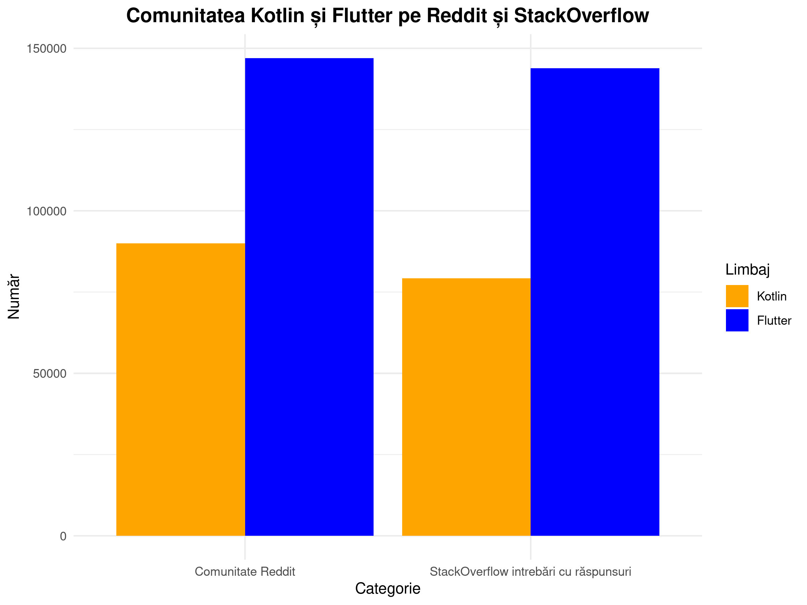
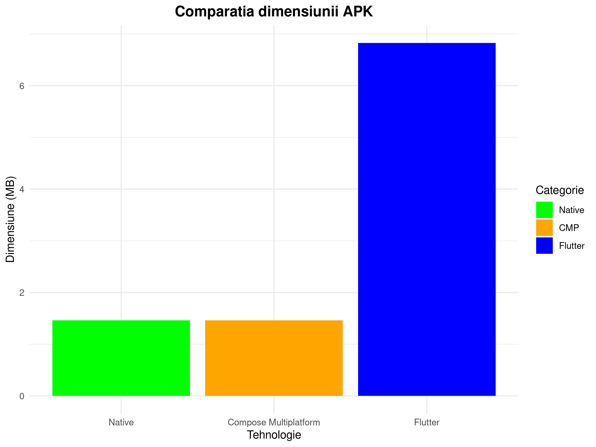
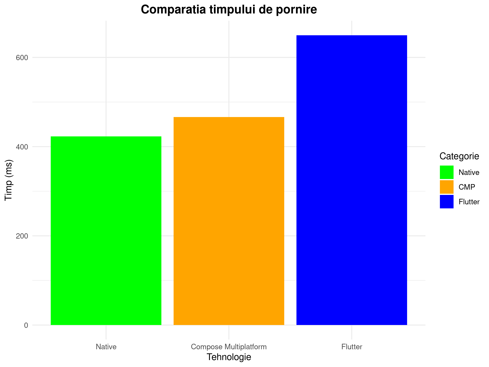
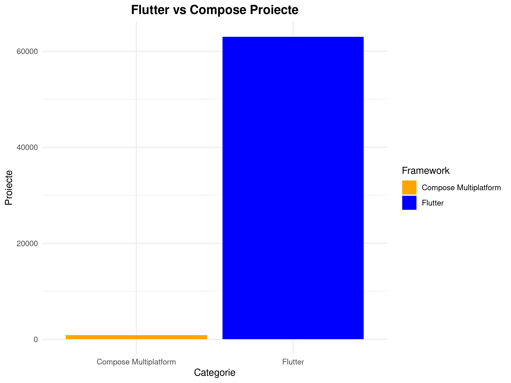

# **Analiza Compose Multiplatform pentru dezvoltarea de aplicații cross-platform**  

::: {custom-style="Bio"}
**Autor**: Pleșu Cătălin  

**Departamentul Ingineria Software și Automatică, Facultatea Calculatoare
Informatică și Microelectronică, Universitatea Tehnică a Moldovei, Chișinău,
Republica Moldova**  

**Cuvinte cheie:** Compose Multiplatform, Kotlin Multiplatform, Flutter, cross-platform  
:::

---

## Rezumat
Acest articol analizează maturitatea framework-ului Compose Multiplatform în
comparație cu Flutter pentru dezvoltarea de aplicații cross-platform.
Prin această cercetare se dorește a determina dacă este mai bine de utilizat
Compose sau Flutter pentru a crea noi aplicații cross-platform sau posibil
rescrierea aplicațiilor vechi din Flutter în Compose. S-a identificat că
avantajele Compose țin de performanță, iar avantajele Flutter ce ține
de comunitate.

---

## Introducere

Pe piața smartphone-urilor există două sisteme de operare majore: Android și iOS
[1]. Acest fapt creează dificultăți pentru companii să dezvolte
aplicații pentru ambele platforme, fiindcă soluția nativă pentru ambele
utilizează limbaje de programare diferite. Cu scopul de a economisi resurse, pe
piață au apărut mai multe framework-uri pentru a crea aplicații cross-platform,
majoritatea dintre ele suportă și aplicații desktop sau web. 

Printre cele mai populare framework-uri cu acest scop se numără Flutter și React
Native [2]. Pe lângă aceste framework-uri, o tehnologie care a apărut recent este
Kotlin Multiplatform (KMP) [3] care permite reutilizarea logicii aplicației pe
diverse platforme. Bazat pe KMP a fost creat Compose Multiplatform (CMP), care
permite, la rândul său, crearea de interfețe grafice pe mai multe platforme.

Motivul comparării acestor framework-uri este pentru a identifica de ce
popularitatea CMP este mică, deși numărul de programatori care programează în
Kotlin este mai mare decât numărul de programatori care programează în Dart.
Conform sondajului Stack Overflow [4], printre programatorii profesioniști,
popularitatea Kotlin este de 9,9%, iar pentru Dart de 6%, ceea ce înseamnă că
dacă CMP este un framework matur, atunci numărul de aplicații
cross-platfrom scrise în Kotlin ar putea întrece numărul de aplicații
cross-platform scrise în Flutter

Această cercetare își pune ca scop să determine dacă Compose Multiplatform
poate înlocui Flutter ca instrument pentru crearea de apliații cross-platform.

### Flutter
Flutter este un framework pentru crearea aplicațiilor cross-platform dintr-o
singură bază de cod [5]. Acest framework a fost creat de Google în 2017 și deja
este considerat un proiect matur. Flutter are posibilitatea de a crea aplicații
mobile, desktop, dar și pagini web.

Comunitatea de dezvoltatori Flutter este mare, pe GitHub acest proiect are
peste 168k stele [6]. Acesta este unul dintre beneficiile pe care
le are Flutter, existând o mulțime de resurse, sau chiar posibilitatea de a
putea întrebări pe Stack Overflow sau Reddit.

### Compose Multiplatform
Cum a fost deja menționat, Compose Multiplatform este un framework mai nou, cum
se observă după numărul de 1.2K [7] de stele pe GitHub. Un dezavantaj asociat
cu acest lucru este că mai puțini oameni sunt interesați de această tehnologie.
Resursele fiind limitate și comunitatea mică.
resurse.

---

## Analiza 

În primul rând, au fost compilate datele de pe Stack Overflow din anii 2019-2024 [4]
ce țin de popularitatea Kotlin și Dart în rândul dezvoltatorilor
profesioniști. Aceste date pot fi vizualizate în figura 1 de mai jos. Cum poate
fi observat Kotlin a fost mereu mai popular ca Dart, iar pentru 2024
pare că Kotlin va continua să crească în popularitate iar Dart va scădea.
O nuanță a acestor date este că dezvoltatorii ce cunosc Kotlin pot să utilizeze acest limbaj și în alte scopuri cum ar fi crearea de servicii web. Pe când Dart este folosit în mare parte pentru aplicațiile cross-platform în cadrul framework-ului Flutter.

::: {custom-style="FigureCaption"}
{ width=60% }

Figura 1. Popularitatea în rândul dezvoltatorilor profesioniști
:::

Penru a determina mărimea comunităților acestor limbaje și framework-ului au fost utilizate platformele Reddit și Stack Overflow. Pentru reddit au fost considerați numărul de utilizatori în fiecare communitate, iar pentru Stack Overflow au fost luate numărul de întrebări care au răspunsuri marcate cu tagul respectiv.
În ciuda popularității mai mari (cu 3.9%) comunitatea formată în jurul limbajului Kotlin este mai slabă, iar comunitatea în jurul Compose Multiplatform nici nu există. 
Comunitatea de pe Reddit a Kotlin este mai mică decât cea a Flutter, totodată
pe Stack Overflow au fost răspuns aproape jumătate din numărul de întrebări care au
fost răspuns pentru Flutter, ilustrat în figura 2.
Ce ține de întrebări nu este neapărat un lucru bun faptul că Flutter are
mai multe întrebări acest fapt ar putea indica că documentația Flutter
este mai slabă, sau că dezvoltatorii de aplicații în Flutter se întâlnesc
cu un număr mai mare de probleme decât dezvoltatorii de cod Kotlin.

::: {custom-style="FigureCaption"}
{ width=60% }

Figura 2. Compararea comunităților pe Reddit și Stack Overflow
:::

Pentru compararea performanței au fost efectuate două teste: dimensiunea
aplicației APK și timpul de pornire al aplicației. Această
comparație este disponibilă onlie pe pagina de GitHub a lui Jacob Ras
[8]. Testul include compararea și cu metoda nativă de a crea
aplicații. Deși dispozitivele disponibile pe piață au suficientă memorie,
este neplăcut atunci când o aplicație nu utilizează resursele rațional.
Astfel, primul test a fost efectuat asupra mărimii aplicației după
compilare. Cum poate fi observat din tabelul 1 și figura 3, aplicația Compose
are aceeași mărime ca și cea nativă, pe când cea în Flutter este de
aproape 5 ori mai mare. 

::: {custom-style="TableCaption"}
Tabelul 1. Mărimea aplicației APK compilate 
:::

| Tehnologie           | Android  |
|----------------------|----------|
| **Native** (Compose) | 1.463 MB |
| **KMP** (Compose)    | 1.463 MB |
| **Flutter**          | 6.828 MB |

Dacă este necesar ca aplicația să ruleze chiar și
pe telefoane cu resurse mai limitate, ar fi mai optim de utilizat Native
sau Kotlin, fiindcă acestea utilizează mai puțină memorie, posibil
utilizează mai puțin și din alte resurse. Însă pentru telefoanele noi
rularea de aplicații Flutter nu este o problemă.

::: {custom-style="FigureCaption"}
{ width=60% }

Figura 3. Compararea mărimii aplicației
:::

Următorul test a fost efectuat asupra timpului de pornire, similar cu cazul
paginilor web; dacă aplicația se va porni prea greu, posibil ca utilizatorii să
o închidă și să nu o mai utilizeze. Rezultatele pot fi observate în tabelul 2 și
figura 4. 

::: {custom-style="TableCaption"}
Tabelul 2. Timpul de pornire al aplicației 
:::

| Tehnologie   | min.     | median   | max.     |
|--------------|----------|----------|----------|
| **Native**   | 408.7 ms | 413.1 ms | 423.1 ms |
| **KMP**      | 403.6 ms | 425.3 ms | 466.4 ms |
| **Flutter**  | 600.5 ms | 634.2 ms | 649.8 ms |

În medie, aplicația scrisă în KMP se lansează cu doar 12.2 ms
mai lent decât o aplicație nativă, pe când aplicația scrisă în Flutter se
pornește cu peste 50% mai lent.

::: {custom-style="FigureCaption"}
{ width=60% }

Figura 4. Compararea timpului de pornire al aplicației
:::

Au fost comparate numărul de proiecte publice de pe GitHub care au fost
realizate cu tehnologiile respective. Acest lucru este ilustrat în figura
5. Numărul de proiecte Flutter este 63020 [9], iar de
proiecte Compose Multiplatform 860 [10]. Pe viitor, ar trebui
monitorizat numărul de proiecte pentru a determina dacă CMP este adoptat
de dezvoltatori sau nu.

::: {custom-style="FigureCaption"}
{ width=60% }

Figura 5. Numărul de proiecte publice pe GitHub
:::

---

## Concluzie
CMP este o tehnologie nouă cu perspectivă pentru viitor, însă, la moment
adopția sa este mică. 
Utilizarea acestui framework este recomandat dezvoltatori cu 
experiență în Kotlin sau mai mult pentru învățare. Pentru cineva nou care
dorește să facă aplicații cross-platform fără experiență, ar fi recomandat
Flutter, așa cum comunitatea este mai mare și au fost raspunse sude de mii de
întrebări în comunitatea de pe Stack Overflow.

Realizarea aplicațiilor prin CMP are avantajul dimensiunilor reduse ale
aplicației, posibilitatea de a utiliza mai puține resurse și o performanță mai
bună, iar avantajul Flutter sunt comunitatea mare care poate să vă ajute să
depășiti problme în timpul dezvoltării.

Pentru ca CMP să devină o alternativă mai viabilă, în primul rând ar trebui ca
mai mulți dezvoltatori să îl utilizeze pentru a mări comunitatea, sau ca
comunitatea Kotlin în general să fie mai colaborativă.

---

## Referințe
::: {custom-style="Ref"}
[1] Statista, „Global market share held by mobile operating systems since 2009.” [Online]. Url: [https://www.statista.com/statistics/272698/global-market-share-held-by-mobile-operating-systems-since-2009/](https://www.statista.com/statistics/272698/global-market-share-held-by-mobile-operating-systems-since-2009/)  

[2] JetBrains, „Popular cross-platform app development frameworks.” [Online]. Url: [https://www.jetbrains.com/help/kotlin-multiplatform-dev/cross-platform-frameworks.html#popular-cross-platform-app-development-frameworks](https://www.jetbrains.com/help/kotlin-multiplatform-dev/cross-platform-frameworks.html#popular-cross-platform-app-development-frameworks)  

[3] JetBrains, „Kotlin Multiplatform.” [Online]. Url: [https://www.jetbrains.com/kotlin-multiplatform/](https://www.jetbrains.com/kotlin-multiplatform/)  

[4] Stack Overflow, „Most popular technologies – language proficiency (2024 survey).” [Online]. Url: [https://survey.stackoverflow.co/2024/technology#most-popular-technologies-language-prof](https://survey.stackoverflow.co/2024/technology#most-popular-technologies-language-prof)  

[5] Flutter, „Flutter - Build apps for any screen.” [Online]. Url: [https://flutter.dev/](https://flutter.dev/)  

[6] Flutter, „Flutter GitHub Repository.” [Online]. Url: [https://github.com/flutter/flutter](https://github.com/flutter/flutter)  

[7] JetBrains, „Compose Multiplatform GitHub Repository.” [Online]. Url: [https://github.com/JetBrains/compose-multiplatform](https://github.com/JetBrains/compose-multiplatform)  

[8] J. Ras, „Flutter vs Native vs KMP Comparison.” [Online]. Url: [https://github.com/jacobras/flutter-vs-native-vs-kmp](https://github.com/jacobras/flutter-vs-native-vs-kmp)  

[9] GitHub, „Flutter Topics on GitHub.” [Online]. Url: [https://github.com/topics/flutter](https://github.com/topics/flutter)  

[10] GitHub, „Compose Multiplatform Topics on GitHub.” [Online]. Url: [https://github.com/topics/compose-multiplatform](https://github.com/topics/compose-multiplatform) 
:::
