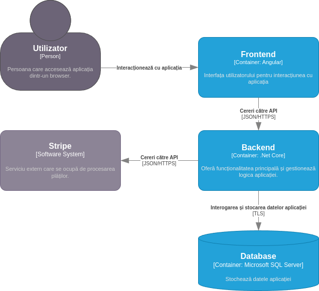
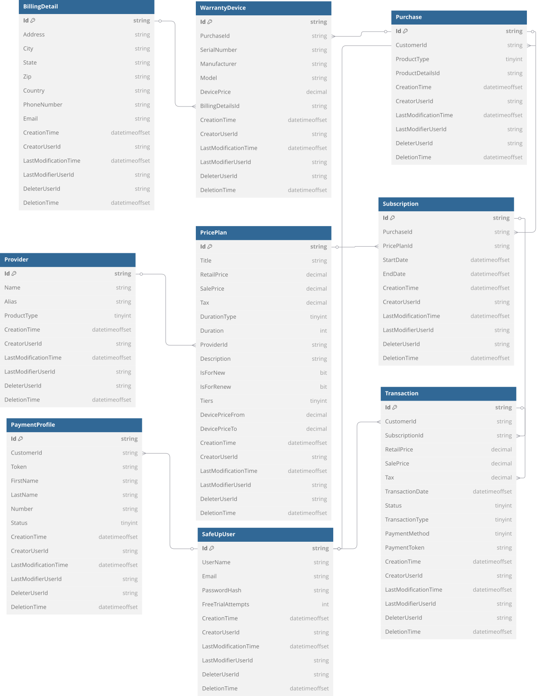
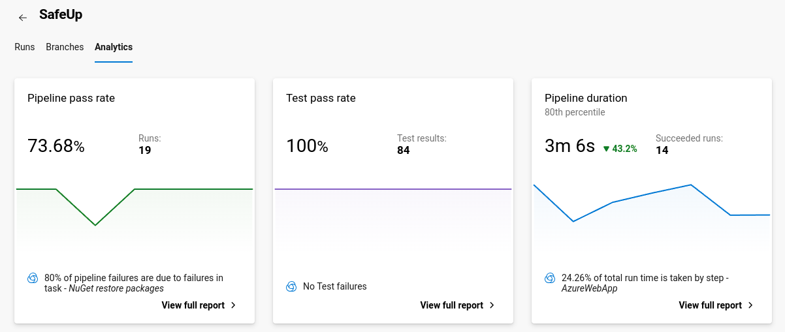
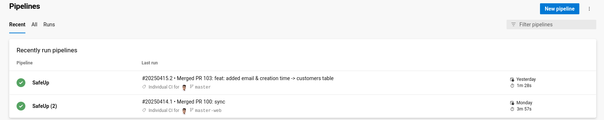

# 1. Introducere

SafeUp este o platformă web care oferă garanții digitale pentru telefoane mobile, sub formă de abonamente flexibile. Utilizatorii își pot proteja dispozitivele împotriva unor riscuri comune precum furtul, pierderea sau deteriorarea accidentală. Platforma simplifică procesul de asigurare și oferă o alternativă superioară garanțiilor tradiționale, adesea limitate în acoperire și greu de gestionat.

SafeUp răspunde unei nevoi reale pe piața din Republica Moldova, unde serviciile de asigurare pentru telefoane mobile sunt aproape inexistente. În mod obișnuit, garanțiile oferite de producători sau comercianți acoperă doar defecte de fabricație, fără să includă evenimente neprevăzute cauzate de utilizator sau de factori externi.

Obiectivul principal al platformei este de a democratiza accesul la protecția digitală a telefoanelor mobile, oferind o experiență online intuitivă, transparentă și adaptată bugetului fiecărui utilizator. Fiecare plan de abonament vine cu informații clare despre costuri, acoperire și durată – fără condiții ascunse sau termeni greu de înțeles. Utilizatorii pot alege rapid opțiunea care se potrivește cel mai bine nevoilor lor, iar plata se efectuează în siguranță prin [Stripe](https://stripe.com/) – un procesator de plăți recunoscut la nivel global pentru securitatea și fiabilitatea sa.

Pentru a înțelege poziționarea SafeUp în context internațional, putem menționa câteva servicii similare:

| Serviciu    | Dispozitiv vizat| Cost |
|----------------------------------|------------------------|-----------------------------------------|
| [AppleCare+](https://www.apple.com/support/products/) | iPhone   | De la $9.99/lună sau $99.99/an   |
| [SquareTrade - Phone Protection](https://www.squaretrade.com/phone-protection/) | Orice telefon   | $8.99/lună  |
| [T-Mobile Protection 360](https://www.t-mobile.com/benefits/phone-protection-plans) | Dispozitive T-Mobile   | Între $7 și $25/lună      |

Platforma a fost dezvoltată cu accent pe performanță, scalabilitate și mentenanță facilă, utilizând o stivă tehnologică modernă:

- **Frontend:** Dezvoltat în Angular cu TypeScript, oferă o interfață dinamică, responsivă și intuitivă. Angular permite construirea de aplicații complexe și reactive, iar TypeScript adaugă siguranță și claritate codului, facilitând dezvoltarea și întreținerea pe termen lung.

- **Backend:** Implementat în .NET Core cu C#, backend-ul este robust, scalabil și optimizat pentru performanță. C# este ideal pentru aplicații de mari dimensiuni, oferind un ecosistem matur și bine documentat.

- **Baza de date:** Platforma folosește Microsoft SQL Server, un SGBDR fiabil și scalabil, găzduit în Azure SQL Database – un serviciu cloud gestionat care oferă performanță constantă și disponibilitate ridicată.

- **Infrastructură și DevOps:** Găzduirea este asigurată pe Microsoft Azure, iar livrarea continuă a aplicației este realizată prin CI/CD cu Azure DevOps, care automatizează procesele de build, testare și implementare, oferind actualizări rapide și fiabile.

SafeUp combină tehnologia de ultimă generație cu o viziune clară asupra nevoilor utilizatorilor moderni. Este mai mult decât o aplicație – este un pas înainte în direcția unei protecții accesibile și transparente pentru fiecare telefon mobil.

# 2. Arhitectura sistemului

Arhitectura sistemului SafeUp descrie interacțiunile dintre principalele componente ale aplicației: frontend, backend și baza de date. Acestea sunt interconectate într-o infrastructură cloud, găzduită în Azure, iar pentru procesarea plăților, aplicația utilizează Stripe.

{ width=600px }

Aplicația este structurată în:

- Frontend – SafeUp.Web (Angular): Interfața cu care utilizatorii interacționează direct, responsabilă pentru prezentarea datelor și comunicarea cu backendul.
- Backend – SafeUp.Api (.NET Core): Oferă funcționalitatea principală a aplicației, gestionează logica de afaceri și integrează Stripe API pentru procesarea plăților.
- Bază de date – SQL Server (Azure SQL Database): Stochează datele persistente ale aplicației.

Diagrama „Structura bazei de date” prezintă schema tabelelor și relațiile dintre acestea în Azure SQL Database. Aceasta include tabele pentru stocarea informațiilor despre utilizatori, comenzi și tranzacții, asigurând persistarea datelor necesare funcționării aplicației.

{ width=600px }

Schema include tabele pentru:

- SafeUpUser: Informații despre utilizatorii înregistrați.
- BillingDetail: Detalii de facturare.
- Provider: Informații despre furnizori.
- PricePlan: Detalii despre planurile de preț.
- Purchase: Înregistrări ale achizițiilor.
- Subscription: Detalii despre subscripții.
- Transaction: Înregistrări ale tranzacțiilor financiare.
- WarrantyDevice: Informații despre dispozitivele cu garanție.
- PaymentProfile: Detalii despre metodele de plată salvate.

Această arhitectură asigură o integrare eficientă și sigură între componentele aplicației, oferind o experiență fluidă și securizată pentru utilizatori.


# 3. Endpoint-uri API

Backendul aplicației SafeUp expune o serie de endpoint-uri API RESTful care sunt consumate de frontend pentru a oferi funcționalitatea completă a aplicației. Aceste endpoint-uri permit frontendului să interacționeze cu logica de afaceri și cu datele stocate în baza de date. Mai jos este o listă a principalelor categorii de endpoint-uri disponibile, urmată de o descriere succintă a scopului fiecăreia:

**Warranties**: Aceste endpoint-uri sunt utilizate pentru a gestiona informațiile despre garanțiile asociate produselor achiziționate prin SafeUp. Ele ar putea permite înregistrarea unei garanții, vizualizarea detaliilor unei garanții sau verificarea stării acesteia.

* _POST /api/Warranties/check_:
    * **Parametri:** Nu are parametri specificați.
    * **Corpul Cererii (application/json):**

        ```
        {
            "imei": "string"
        }
        ```

    * **Descriere:** Lipsă în lista furnizată.
* _POST /api/Warranties/devices_:
    * **Parametri:** Nu are parametri specificați.
    * **Corpul Cererii (application/json):**

        ```
        {
            "pricePlanId": "string",
            "paymentProfileId": "string",
            "isAutoPay": true,
            "serialNumber": "string",
            "manufacturer": "string",
            "model": "string",
            "devicePrice": 0,
            "address": "string",
            "city": "string",
            "state": "string",
            "zip": "string",
            "country": "string",
            "phoneNumber": "string",
            "email": "string"
        }
        ```

    * **Descriere:** Lipsă în lista furnizată.

**Users**: Acest set de endpoint-uri este dedicat gestionării utilizatorilor aplicației. Acesta include operațiuni pentru înregistrare, autentificare, actualizarea informațiilor de profil, recuperarea parolei și eventual gestionarea rolurilor și permisiunilor.

* _POST /api/Users/register_:
    * **Parametri:** Nu are parametri specificați.
    * **Corpul Cererii (application/json):**

        ```
        {
            "userName": "string",
            "email": "string",
            "password": "string"
        }
        ```

* _POST /api/Users/login_:
    * **Parametri:** Nu are parametri specificați.
    * **Corpul Cererii (application/json):**

        ```
        {
            "username": "string",
            "password": "string"
        }
        ```

* _GET /api/Users_:
    * **Parametri:** Nu are parametri specificați.
* _POST /api/Users/users_:
    * **Parametri:** Nu are parametri specificați.
* _GET /api/Users/user-policy_:
    * **Parametri:** Nu are parametri specificați.
* _GET /api/Users/moderator-policy_:
    * **Parametri:** Nu are parametri specificați.
* _GET /api/Users/admin-policy_:
    * **Parametri:** Nu are parametri specificați.
* _GET /api/Users/super-admin-policy_:
    * **Parametri:** Nu are parametri specificați.

**Transactions**: Aceste endpoint-uri oferă acces la istoricul tranzacțiilor financiare efectuate de utilizatori. Ele pot permite listarea tranzacțiilor, obținerea detaliilor unei tranzacții specifice și verificarea stării plății.

* _GET /api/Transactions/{id}_:
    * **Parametri:** `id` (string, path).
* _POST /api/Transactions/paginated_:
    * **Parametri:** Nu are parametri specificați.
    * **Corpul Cererii (application/json):**

        ```
        {
            "page": 0,
            "pageSize": 0
        }
        ```

**Subscriptions**: Aceste endpoint-uri sunt responsabile pentru gestionarea subscripțiilor utilizatorilor. Ele permit crearea, vizualizarea, modificarea sau anularea subscripțiilor, precum și verificarea stării unei subscripții.

* _GET /api/Subscriptions/{id}_:
    * **Parametri:** `id` (string, path).
* _POST /api/Subscriptions/paginated_:
    * **Parametri:** Nu are parametri specificați.
    * **Corpul Cererii (application/json):**

        ```
        {
            "page": 0,
            "pageSize": 0
        }
        ```

**Purchases**: Aceste endpoint-uri gestionează procesul de achiziție al utilizatorilor. Ele permit crearea de noi achiziții, vizualizarea istoricului achizițiilor unui utilizator și obținerea detaliilor specifice ale unei achiziții.

* _GET /api/Purchases/{id}_:
    * **Parametri:** `id` (string, path).
* _POST /api/Purchases/paginated_:
    * **Parametri:** Nu are parametri specificați.
    * **Corpul Cererii (application/json):**

        ```
        {
            "page": 0,
            "pageSize": 0
        }
        ```

**PricePlans**: Aceste endpoint-uri oferă acces la informațiile despre diferitele planuri de preț oferite de aplicație. Frontendul le utilizează pentru a afișa opțiunile disponibile utilizatorilor, inclusiv detalii despre preț, durată și beneficii.

* _GET /api/PricePlans/{id}_:
    * **Parametri:** `id` (string, path).
* _DELETE /api/PricePlans/{id}_:
    * **Parametri:** `id` (string, path).
* _POST /api/PricePlans/paginated_:
    * **Parametri:** Nu are parametri specificați.
    * **Corpul Cererii (application/json):**

        ```
        {
            "page": 0,
            "pageSize": 0
        }
        ```
* _POST /api/PricePlans_:
    * **Parametri:** Nu are parametri specificați.
    * **Corpul Cererii (application/json):**

        ```
        {
            "title": "string",
            "retailPrice": 0,
            "salePrice": 0,
            "tax": 0,
            "durationType": "None",
            "duration": 0,
            "providerId": "string",
            "description": "string",
            "isForNew": true,
            "isForRenew": true,
            "tiers": "None",
            "devicePriceFrom": 0,
            "devicePriceTo": 0
        }
        ```

* _PUT /api/PricePlans_:
    * **Parametri:** Nu are parametri specificați.
    * **Corpul Cererii (application/json):**

        ```
        {
            "id": "string",
            "title": "string",
            "retailPrice": 0,
            "salePrice": 0,
            "tax": 0,
            "durationType": "None",
            "duration": 0,
            "providerId": "string",
            "description": "string",
            "isForNew": true,
            "isForRenew": true,
            "tiers": "None",
            "devicePriceFrom": 0,
            "devicePriceTo": 0
        }
        ```

* _GET /api/PricePlans/durations_:
    * **Parametri:** Nu are parametri specificați.
* _GET /api/PricePlans/tiers_:
    * **Parametri:** Nu are parametri specificați.

**Payments**: Acest set de endpoint-uri este dedicat gestionării procesului de plată, integrând serviciul Stripe. Acestea ar include operațiuni pentru inițierea plăților, verificarea stării tranzacțiilor, gestionarea metodelor de plată salvate ale utilizatorilor și eventual rambursări.

* _POST /api/Payments_:
    * **Parametri:** Nu are parametri specificați.
    * **Corpul Cererii (application/json):**

        ```
        {
            "token": "pk_test_51RAR2I4KLpqqcjXMVBPa8Z6cfSKAFCAMtan29KGG4mrBN4l9qh3mzy6natcTQ9hT7QEpKhtTbLhOzODmYioePolQ00BpxpaEpq"
        }
        ```

* _POST /api/Payments/paginated_:
    * **Parametri:** Nu are parametri specificați.
    * **Corpul Cererii (application/json):**

        ```
        {
            "page": 0,
            "pageSize": 0
        }
        ```

**Configurations**: Acesta este utilizat pentru a prelua setări generale ale aplicației. La moment, prin acest endpoint se transmite doar cheia publică de acces a serviciului Stripe.

* _GET /api/Configurations_:
    * **Parametri:** Nu are parametri specificați.

# 4. Testare și Deployment

Testarea reprezintă o etapă fundamentală în ciclul de viață al dezvoltării software, având ca scop identificarea defectelor și asigurarea calității aplicației. Testarea frontendului a fost realizată manual, o metodă care implică evaluarea interfeței utilizator de către persoane fizice. Această abordare este esențială pentru a valida aspecte precum usabilitatea, experiența utilizatorului, designul vizual și conformitatea cu cerințele funcționale din perspectiva utilizatorului final.

{ width=600px }

Pentru backend, s-a adoptat o strategie de testare automată, utilizând framework-ul xUnit. Testarea automată presupune scrierea de cod (teste) care verifică funcționarea corectă a unităților de cod (funcții, metode, clase) în mod independent. Framework-uri precum xUnit oferă structura și instrumentele necesare pentru a organiza, executa și raporta rezultatele acestor teste. Testele unitare sunt cruciale pentru a asigura robustetea și fiabilitatea logicii de afaceri, permițând detectarea timpurie a erorilor introduse prin modificări de cod și facilitând refactorizarea sigură a codului. Imaginea ilustrează probabil un raport al execuției testelor xUnit, indicând numărul de teste rulate, cele care au trecut și cele care au eșuat.

{ width=600px }

Integrarea continuă (CI) și plasarea continuă (CD) sunt practici DevOps esențiale pentru automatizarea procesului de livrare a software-ului. Integrarea continuă se referă la practica de a integra frecvent modificările de cod din ramurile de dezvoltare principale, urmând ca aceste modificări să fie construite și testate automat. Scopul CI este de a detecta cât mai devreme posibil problemele de integrare. Plasarea continuă extinde CI prin automatizarea procesului de lansare a aplicației în mediul țintă (care poate fi un mediu de testare, staging sau producție) după ce a trecut cu succes toate etapele de testare.

În implementarea noastră, procesul de livrare continuă este orchestrat prin pipeline-uri separate în Azure DevOps pentru frontend și backend. Există un pipeline dedicat integrării continue și plasării continue pentru frontend și un altul similar pentru backend. Ambele pipeline-uri de integrare continuă (CI) sunt declanșate manual, o decizie luată pentru a ne încadra în constrângerile planului de buget gratuit oferit de Azure DevOps pentru servicii.

Pentru backend, pipeline-ul automatizează preluarea codului sursă, execută analize statice, compilează aplicația și rulează testele unitare (xUnit). Dacă toate etapele CI sunt finalizate cu succes, se trece automat la etapa de plasare continuă (CD), unde artefactele build-uite sunt distribuite în mediul țintă.

Similar, pentru frontend, există un pipeline separat care, odată declanșat manual pentru integrarea continuă (construire, testare specifică frontendului), execută automat și etapa de plasare continuă (CD), publicând noua versiune a frontendului în mediul corespunzător.

Astfel, deși avem pipeline-uri separate pentru frontend și backend, fiecare dintre aceste pipeline-uri înglobează atât etapele de Integrare Continuă (CI) cât și pe cele de Plasare Continuă (CD), formând un flux de lucru complet automatizat de la integrarea codului până la implementare, odată ce declanșarea manuală a CI a fost efectuată.


# 5. Concluzie

În concluzie, SafeUp reprezintă o abordare inovatoare și bine fundamentată pentru a răspunde nevoii de protecție extinsă a telefoanelor mobile pe piața din Republica Moldova, oferind o alternativă digitală superioară garanțiilor tradiționale. Prin combinarea unei arhitecturi solide, bazată pe tehnologii moderne și scalabile precum .NET Core, Angular și Azure, cu un proces de dezvoltare riguros care include testare automată și integrare/livrare continuă, proiectul demonstrează un potențial semnificativ de a oferi o platformă fiabilă și ușor de utilizat. Integrarea cu Stripe pentru procesarea plăților adaugă un nivel esențial de funcționalitate și securitate. SafeUp se distinge prin acoperirea extinsă (furt, pierdere, defecțiuni), flexibilitatea abonamentelor și transparența costurilor, adresându-se direct lacunelor identificate pe piața locală. Prin urmare, SafeUp are toate premisele pentru a deveni o soluție de referință pentru protecția telefoanelor mobile, oferind utilizatorilor control și liniște sufletească.

***

# 6. Referințe

1. [.NET Core Docs](https://docs.microsoft.com/en-us/aspnet/core)
2. [NSwag GitHub](https://github.com/RicoSuter/NSwag)
3. [Stripe API Reference (.NET)](https://docs.stripe.com/api?lang=dotnet)
4. [JWT](https://jwt.io/)
5. [Angular Documentation](https://angular.io/docs)
6. [Angular Material](https://material.angular.io/)
7. [Bootstrap](https://getbootstrap.com/)
